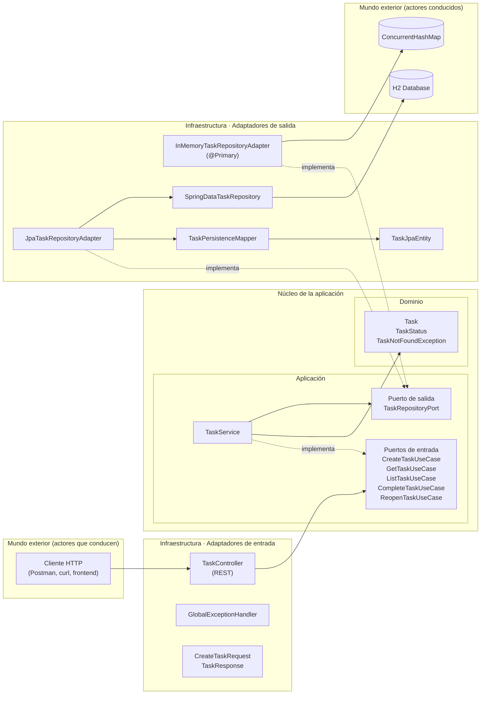
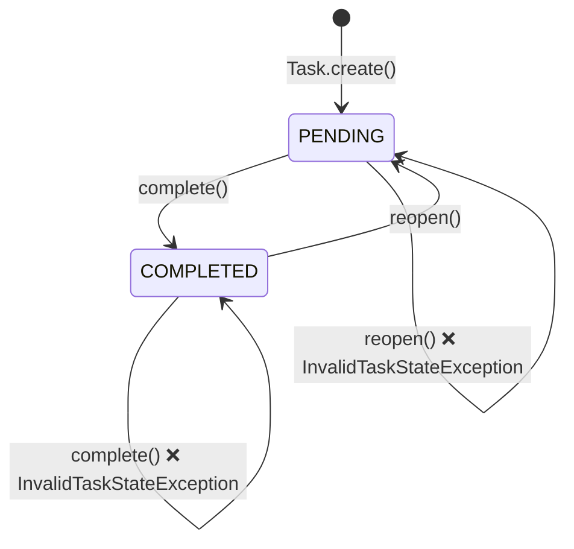
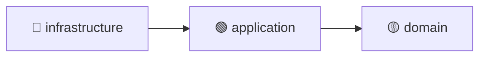
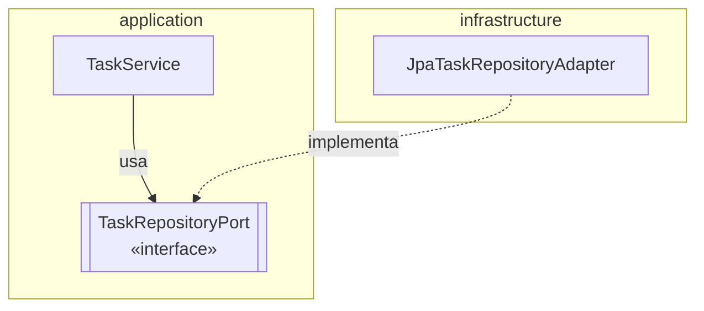
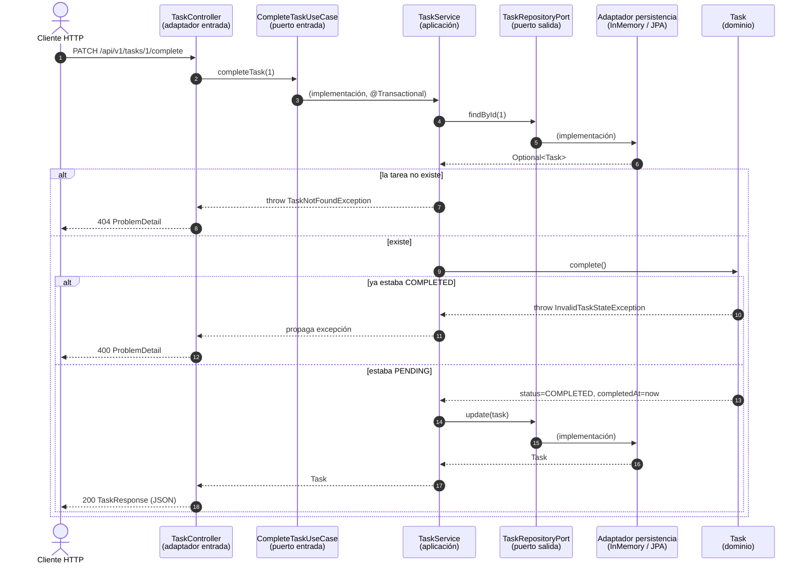
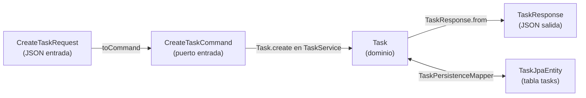

# Todo Hexagonal

Un gestor de tareas (*To-Do*) **deliberadamente simple** cuyo objetivo no es el negocio en sí, sino servir como **base de estudio de la Arquitectura Hexagonal** (también llamada *Ports & Adapters*) usando Java y Spring Boot.

El dominio es mínimo (crear, listar, consultar, completar y reabrir tareas) para que toda la atención quede en **cómo se organiza el código**, **en qué dirección apuntan las dependencias** y **cómo se puede reemplazar la infraestructura sin tocar el núcleo**.

---

## Tabla de contenido

1. [Stack tecnológico](#stack-tecnológico)
2. [¿Qué es la Arquitectura Hexagonal?](#qué-es-la-arquitectura-hexagonal)
3. [Vista general del proyecto](#vista-general-del-proyecto)
4. [Estructura de paquetes](#estructura-de-paquetes)
5. [Las capas en detalle](#las-capas-en-detalle)
   - [Dominio](#1-dominio-domain)
   - [Aplicación: puertos y casos de uso](#2-aplicación-application)
   - [Infraestructura: adaptadores](#3-infraestructura-infrastructure)
6. [La regla de dependencia](#la-regla-de-dependencia)
7. [Recorrido de una petición de punta a punta](#recorrido-de-una-petición-de-punta-a-punta)
8. [Intercambiar adaptadores: el poder de los puertos](#intercambiar-adaptadores-el-poder-de-los-puertos)
9. [Modelos separados por capa y mappers](#modelos-separados-por-capa-y-mappers)
10. [Manejo de errores entre capas](#manejo-de-errores-entre-capas)
11. [API REST](#api-rest)
12. [Cómo ejecutar](#cómo-ejecutar)
13. [Decisiones de diseño](#decisiones-de-diseño)
14. [Ejercicios propuestos](#ejercicios-propuestos)

---

## Stack tecnológico

| Herramienta        | Versión / Uso                                   |
|--------------------|-------------------------------------------------|
| Java               | 25                                              |
| Spring Boot        | 4.1.1 (Web MVC, Data JPA, Validation)           |
| H2                 | Base de datos en memoria (para el adaptador JPA)|
| Lombok             | Reducción de *boilerplate*                      |
| Maven              | Build (incluye *wrapper* `mvnw`)                |

---

## ¿Qué es la Arquitectura Hexagonal?

Propuesta por **Alistair Cockburn** (2005), la Arquitectura Hexagonal busca que **la lógica de negocio sea independiente de los detalles técnicos**: frameworks, bases de datos, interfaces web, colas de mensajes, etc.

La idea central:

> La aplicación es un núcleo que se comunica con el mundo exterior **solo a través de puertos** (interfaces). Las tecnologías concretas se conectan a esos puertos mediante **adaptadores**.

Conceptos clave:

| Concepto | Qué es | En este proyecto |
|---|---|---|
| **Dominio** | Entidades y reglas de negocio puras. | `Task`, `TaskStatus`, `TaskNotFoundException` |
| **Puerto de entrada** (*driving / primary port*) | Interfaz que define **lo que la aplicación ofrece** (casos de uso). | `CreateTaskUseCase`, `CompleteTaskUseCase`, … |
| **Puerto de salida** (*driven / secondary port*) | Interfaz que define **lo que la aplicación necesita** del exterior. | `TaskRepositoryPort` |
| **Servicio de aplicación** | Implementa los puertos de entrada orquestando dominio y puertos de salida. | `TaskService` |
| **Adaptador de entrada** (*driving adapter*) | Traduce un estímulo externo (HTTP, CLI, mensaje) a una llamada a un puerto de entrada. | `TaskController` |
| **Adaptador de salida** (*driven adapter*) | Implementa un puerto de salida con una tecnología concreta. | `JpaTaskRepositoryAdapter`, `InMemoryTaskRepositoryAdapter` |

¿Por qué un **hexágono**? La forma no tiene significado técnico; solo pretende romper con el clásico dibujo de capas apiladas (arriba/abajo) y transmitir que la aplicación tiene **múltiples lados** por donde puede conectarse con el exterior, todos equivalentes.

---

## Vista general del proyecto



Lectura del diagrama:

- **Lado izquierdo (entrada / *driving side*)**: quien *inicia* la interacción (un cliente HTTP). El adaptador REST la traduce a una llamada a un caso de uso.
- **Centro (núcleo)**: aplicación + dominio. No conoce HTTP, JSON, JPA ni H2.
- **Lado derecho (salida / *driven side*)**: aquello que la aplicación *usa* (persistencia). Hay **dos adaptadores** para el **mismo puerto**.

---

## Estructura de paquetes

```
src/main/java/com/app/todo_hexagonal
│
├── TodoHexagonalApplication.java            ← Punto de arranque (Spring Boot)
│
├── domain/                                  ← 🟡 NÚCLEO: reglas de negocio puras
│   ├── model/
│   │   ├── Task.java                        ← Entidad de dominio con comportamiento
│   │   └── TaskStatus.java                  ← PENDING | COMPLETED
│   └── exception/                           ← Excepciones de negocio
│       ├── TaskNotFoundException.java
│       ├── InvalidTaskStateException.java   ← Transición de estado no permitida
│       └── TaskValidationException.java     ← Invariante violada al crear
│
├── application/                             ← 🟢 NÚCLEO: casos de uso
│   ├── port/
│   │   ├── in/                              ← Puertos de ENTRADA (lo que ofrezco)
│   │   │   ├── CreateTaskCommand.java       ← Datos de entrada de "crear tarea"
│   │   │   ├── CreateTaskUseCase.java
│   │   │   ├── GetTaskUseCase.java
│   │   │   ├── ListTaskUseCase.java
│   │   │   ├── CompleteTaskUseCase.java
│   │   │   └── ReopenTaskUseCase.java
│   │   └── out/                             ← Puertos de SALIDA (lo que necesito)
│   │       └── TaskRepositoryPort.java
│   └── service/
│       └── TaskService.java                 ← Implementa los casos de uso
│
└── infrastructure/                          ← 🔵 BORDE: detalles técnicos
    └── adapter/
        ├── in/                              ← Adaptadores de ENTRADA
        │   └── rest/
        │       ├── TaskController.java
        │       ├── GlobalExceptionHandler.java
        │       └── dto/
        │           ├── CreateTaskRequest.java
        │           └── TaskResponse.java
        └── out/                             ← Adaptadores de SALIDA
            └── persistence/
                ├── InMemoryTaskRepositoryAdapter.java
                ├── JpaTaskRepositoryAdapter.java
                ├── SpringDataTaskRepository.java
                ├── TaskJpaEntity.java
                └── TaskPersistenceMapper.java
```

La estructura de paquetes **es la arquitectura**: con solo leer los nombres se entiende qué es núcleo, qué es borde, qué entra y qué sale. Esto se conoce como *screaming architecture* (la estructura "grita" su intención).

---

## Las capas en detalle

### 1. Dominio (`domain`)

Es el **corazón** del sistema. Contiene el modelo y las reglas que serían verdad aunque no existiera Spring, ni una base de datos, ni una API web.

#### `Task` — una entidad con comportamiento

```java
public static Task create(String title, String description) {
    if (title == null || title.isBlank()) {
        throw new TaskValidationException("El título de la tarea es obligatorio");
    }
    return Task.builder()
            .title(title)
            .description(description)
            .status(TaskStatus.PENDING)
            .createdAt(LocalDateTime.now())
            .build();
}

public void complete() {
    if (status == TaskStatus.COMPLETED) {
        throw new InvalidTaskStateException("La tarea ya está completada");
    }
    status = TaskStatus.COMPLETED;
    completedAt = LocalDateTime.now();
}

public void reopen() {
    if (status == TaskStatus.PENDING) {
        throw new InvalidTaskStateException("La tarea ya está pendiente");
    }
    status = TaskStatus.PENDING;
    completedAt = null;
}
```

Puntos a destacar:

- **Las reglas viven en la entidad**, no en el servicio ni en el controlador. "No se puede completar una tarea ya completada" es una **invariante de negocio**, y la protege el propio objeto `Task`.
- Esto evita el **modelo anémico** (objetos que solo tienen getters/setters y cuya lógica está dispersa en servicios). `Task` **no tiene setters**: su estado solo cambia mediante `complete()` y `reopen()`.
- **`Task.create(...)` es la única forma de crear una tarea nueva.** Es un *factory method* (constructor con nombre) que valida las invariantes (título obligatorio) y aplica los valores por defecto (`PENDING` y fecha de creación). Así, ni el controlador ni los adaptadores de persistencia deciden cómo nace una tarea.
- **`Task.builder()` sirve solo para reconstruir** una tarea que ya existe (por ejemplo, al leerla de la base de datos en `TaskPersistenceMapper`), donde no se deben volver a aplicar los valores por defecto.
- **La identidad es el `id`**: dos `Task` son iguales si tienen el mismo `id`. Dos tareas nuevas (sin `id`) solo son iguales si son la misma instancia.

#### Máquina de estados de una tarea



#### Excepciones de negocio

`TaskNotFoundException`, `InvalidTaskStateException` y `TaskValidationException` expresan los errores en el lenguaje del dominio ("la tarea no existe", "la tarea ya está completada", "el título es obligatorio"). Nótese que **no** saben nada de HTTP 404 o 400; esa traducción la hace la infraestructura (ver [Manejo de errores](#manejo-de-errores-entre-capas)).

Se usan excepciones propias en lugar de `IllegalStateException` para que el contrato sea explícito y para que el manejador HTTP no convierta en 400 cualquier `IllegalStateException` técnica que lance otra librería.

> ✅ **Regla:** el paquete `domain` no importa nada de `application` ni de `infrastructure`, ni de Spring.

---

### 2. Aplicación (`application`)

Orquesta el dominio para cumplir **casos de uso**. Define los **puertos**, que son los contratos con el exterior.

#### Puertos de entrada (`port/in`) — *lo que la aplicación ofrece*

Cada caso de uso es una **interfaz independiente**:

```java
public interface CompleteTaskUseCase {
    Task completeTask(Long id);
}
```

¿Por qué una interfaz por caso de uso y no un único `TaskUseCase` con todos los métodos?

- **Principio de Segregación de Interfaces (ISP)**: cada cliente depende solo de lo que usa.
- **Intención explícita**: la lista de archivos en `port/in` es literalmente el **catálogo de funcionalidades** del sistema.
- **Escalabilidad**: si mañana un caso de uso crece, puede tener su propia implementación sin afectar a los demás.

Los datos de entrada de "crear tarea" viajan en un **comando** propio del puerto, no como una `Task` armada por el adaptador:

```java
public record CreateTaskCommand(String title, String description) {}

public interface CreateTaskUseCase {
    Task create(CreateTaskCommand command);
}
```

Así el adaptador de entrada solo entrega datos, y es el núcleo (vía `Task.create`) quien construye la entidad aplicando sus reglas.

#### Puerto de salida (`port/out`) — *lo que la aplicación necesita*

```java
public interface TaskRepositoryPort {
    Task save(Task task);
    List<Task> listAll();
    Optional<Task> findById(Long id);
    Task update(Task task);
}
```

Este es el punto más importante de toda la arquitectura:

- La interfaz la **define y la posee la aplicación**, no la infraestructura.
- Habla en términos del **dominio** (`Task`), no de `TaskJpaEntity` ni de SQL.
- La aplicación dice *"necesito guardar y recuperar tareas"*, sin importarle **cómo**.

Esto es la **Inversión de Dependencias (la "D" de SOLID)**: el módulo de alto nivel (aplicación) no depende del de bajo nivel (base de datos); **ambos dependen de una abstracción**, y esa abstracción pertenece al de alto nivel.

#### `TaskService` — implementación de los casos de uso

```java
@Service
@Transactional                                 // ← cada caso de uso es una unidad atómica
@RequiredArgsConstructor
public class TaskService implements CreateTaskUseCase, GetTaskUseCase,
        ListTaskUseCase, CompleteTaskUseCase, ReopenTaskUseCase {

    private final TaskRepositoryPort taskRepositoryPort;

    @Override
    public Task create(CreateTaskCommand command) {
        Task task = Task.create(command.title(), command.description());
        return taskRepositoryPort.save(task);
    }

    @Override
    @Transactional(readOnly = true)
    public Task getById(Long id) {
        return findOrThrow(id);
    }

    @Override
    public Task completeTask(Long id) {
        Task task = findOrThrow(id);
        task.complete();                       // ← la regla la aplica el dominio
        return taskRepositoryPort.update(task);
    }
    // ...
}
```

Observa el patrón típico de un caso de uso:

1. **Recuperar** el agregado a través del puerto de salida.
2. **Delegar** la regla de negocio al dominio (`task.complete()`).
3. **Persistir** el resultado a través del puerto de salida.

El servicio **no** valida estados, **no** conoce HTTP, **no** conoce JPA. Solo coordina.

#### Spring en la capa de aplicación: un compromiso consciente

`TaskService` usa dos anotaciones de Spring:

- **`@Service`** lo registra como bean, para que Spring lo inyecte donde se pidan los puertos de entrada.
- **`@Transactional`** convierte cada caso de uso en una **unidad atómica**. Esto importa en los casos que leen y luego escriben (`completeTask`, `reopenTask`) cuando se usa el adaptador JPA. Las consultas usan `readOnly = true`.

En una hexagonal "pura" la capa de aplicación no conocería ningún framework. Aquí se acepta esta dependencia de forma **deliberada** porque:

- Las anotaciones solo **agregan metadatos**; no cambian la lógica del servicio.
- El límite transaccional **pertenece al caso de uso**: es la aplicación quien sabe qué operaciones deben ser atómicas.
- Sigue siendo posible instanciar `TaskService` con `new` en una prueba unitaria; fuera de Spring las anotaciones simplemente se ignoran.

Si se quisiera eliminar esta dependencia, las alternativas son registrar `TaskService` como POJO desde una clase `@Configuration` en infraestructura y manejar las transacciones con un **decorador** (`TransactionTemplate`) o con **AOP** declarado en la configuración. Ambas cuestan más código o más "magia" a cambio de un núcleo sin Spring.

---

### 3. Infraestructura (`infrastructure`)

Es el **borde** del hexágono. Aquí vive todo lo que depende de tecnologías concretas. Se divide en adaptadores de entrada (`in`) y de salida (`out`).

#### Adaptador de entrada: REST (`adapter/in/rest`)

`TaskController` es un **traductor**:

```java
@PostMapping
public ResponseEntity<TaskResponse> createTask(@Valid @RequestBody CreateTaskRequest request) {
    // DTO HTTP → comando del puerto; llamada al PUERTO, no al servicio
    Task saved = createTaskUseCase.create(request.toCommand());

    return ResponseEntity.status(HttpStatus.CREATED)
            .body(TaskResponse.from(saved));        // dominio → DTO HTTP
}
```

Claves:

- El controlador depende de las **interfaces** `CreateTaskUseCase`, `GetTaskUseCase`, etc., **nunca de `TaskService`** directamente. Spring inyecta `TaskService` porque es el bean que implementa esas interfaces.
- Usa **DTOs propios** (`CreateTaskRequest`, `TaskResponse`): el contrato JSON de la API puede evolucionar sin afectar al dominio, y viceversa.
- La **validación de formato** (`@NotBlank`) vive en el DTO: es una preocupación de la entrada HTTP. Aun así, el dominio **vuelve a validar** el título en `Task.create`, porque otro adaptador de entrada (CLI, Kafka…) podría no tener esa validación.

Si mañana se quisiera exponer la misma lógica vía **GraphQL**, **gRPC**, una **CLI** o un **consumidor de Kafka**, bastaría con crear otro adaptador de entrada que llame a los mismos puertos. El núcleo no cambia.

#### Adaptadores de salida: persistencia (`adapter/out/persistence`)

Aquí está la demostración más didáctica del proyecto: **dos implementaciones del mismo puerto**.

| Adaptador | Tecnología | Componentes auxiliares |
|---|---|---|
| `InMemoryTaskRepositoryAdapter` | `ConcurrentHashMap` + `AtomicLong` | — |
| `JpaTaskRepositoryAdapter` | Spring Data JPA + H2 | `SpringDataTaskRepository`, `TaskJpaEntity`, `TaskPersistenceMapper` |

Ambos implementan `TaskRepositoryPort`. El `TaskService` no sabe (ni le importa) cuál de los dos está recibiendo. Ninguno aplica valores por defecto: reciben una `Task` ya válida y solo la guardan.

---

## La regla de dependencia

> **Las dependencias del código fuente siempre apuntan hacia el centro.**



| Paquete | Puede depender de | NO puede depender de |
|---|---|---|
| `domain` | (nada del proyecto) | `application`, `infrastructure`, frameworks |
| `application` | `domain` | `infrastructure` |
| `infrastructure` | `application`, `domain`, frameworks | — |

Una forma rápida de verificarlo es revisar los `import` de cada archivo:

- En `domain/**` no aparece ningún `import com.app.todo_hexagonal.application…` ni `…infrastructure…`.
- En `application/**` no aparece ningún `import …infrastructure…`.

Pero ¿cómo es posible que la aplicación **use** la base de datos sin **depender** de ella? Gracias a la inversión de dependencias:



En **tiempo de ejecución** el flujo va de la aplicación hacia la base de datos, pero en **tiempo de compilación** la flecha de dependencia apunta de la infraestructura hacia la aplicación. Esa inversión es lo que hace al núcleo independiente.

---

## Recorrido de una petición de punta a punta

Ejemplo: `PATCH /api/v1/tasks/1/complete`



Observa cómo cada capa hace **una sola cosa**:

| Paso | Responsable | Responsabilidad |
|---|---|---|
| Recibir HTTP, deserializar JSON | `TaskController` | Traducción de protocolo |
| Orquestar el caso de uso (en una transacción) | `TaskService` | Coordinación |
| Decidir si se puede completar | `Task` | Regla de negocio |
| Guardar | Adaptador de persistencia | Detalle técnico |
| Convertir errores a HTTP | `GlobalExceptionHandler` | Traducción de protocolo |

---

## Intercambiar adaptadores: el poder de los puertos

Actualmente existen **dos beans** que implementan `TaskRepositoryPort`. Spring resuelve la ambigüedad con `@Primary`:

```java
@Repository
@Primary                                   // ← este gana la inyección
public class InMemoryTaskRepositoryAdapter implements TaskRepositoryPort { ... }
```

Por lo tanto, **por defecto la aplicación guarda las tareas en memoria**, y el adaptador JPA queda registrado pero sin usarse.

### Cambiar a persistencia JPA (H2)

Basta con mover `@Primary` de `InMemoryTaskRepositoryAdapter` a `JpaTaskRepositoryAdapter` (o eliminar el adaptador en memoria). **Ningún archivo de `domain` ni de `application` se modifica.** Esa es la prueba concreta de que la arquitectura funciona.

### Alternativas más elegantes para elegir el adaptador

- **Perfiles de Spring**: anotar cada adaptador con `@Profile("memory")` / `@Profile("jpa")` y activar uno con `spring.profiles.active`.
- **Propiedades condicionales**: `@ConditionalOnProperty(name = "app.persistence", havingValue = "jpa")`.
- **Configuración explícita**: una clase `@Configuration` que declare con `@Bean` qué adaptador usar.

### Beneficio para pruebas

Como `TaskService` solo depende de `TaskRepositoryPort`, se puede probar **sin Spring y sin base de datos**, pasándole un adaptador en memoria o un *mock*:

```java
TaskRepositoryPort repo = new InMemoryTaskRepositoryAdapter();
TaskService service = new TaskService(repo);

Task created = service.create(new CreateTaskCommand("Test", "Desc"));
Task completed = service.completeTask(created.getId());

assertEquals(TaskStatus.COMPLETED, completed.getStatus());
```

El proyecto incluye pruebas de este tipo en `TaskTest` (dominio) y `TaskServiceTest` (casos de uso), que se ejecutan en milisegundos sin levantar el contexto de Spring.

---

## Modelos separados por capa y mappers

El mismo concepto "tarea" tiene **tres representaciones**, cada una con un propósito distinto:



| Modelo | Capa | Conoce de | Propósito |
|---|---|---|---|
| `CreateTaskRequest` / `TaskResponse` | Infra (REST) | Jakarta Validation, JSON | Contrato público de la API |
| `CreateTaskCommand` | Aplicación (puerto) | Nada técnico | Datos de entrada del caso de uso |
| `Task` | Dominio | Nada técnico | Reglas de negocio |
| `TaskJpaEntity` | Infra (persistencia) | JPA (`@Entity`, `@Column`…) | Mapeo a la base de datos |

**¿Por qué no usar `@Entity` directamente sobre `Task`?** Porque contaminaría el dominio con detalles de persistencia (anotaciones JPA, constructor vacío obligatorio, *lazy loading*, proxies…). Separar los modelos tiene un costo (los *mappers*), pero a cambio:

- El dominio es **independiente** del ORM.
- El esquema de la base de datos puede cambiar sin tocar el dominio.
- La API pública puede cambiar sin tocar el dominio.

`TaskPersistenceMapper` vive en la infraestructura porque **solo la infraestructura** conoce ambos modelos.

---

## Manejo de errores entre capas

Las excepciones nacen en el núcleo **expresadas en términos de negocio**, y el adaptador REST las **traduce** a HTTP usando `ProblemDetail` (RFC 9457):

| Excepción | Origen | Traducción HTTP (`GlobalExceptionHandler`) |
|---|---|---|
| `TaskNotFoundException` | Aplicación / Dominio | `404 Not Found` — "Tarea no encontrada" |
| `InvalidTaskStateException` | Dominio (`Task.complete()` / `reopen()`) | `400 Bad Request` — "Estado no válido" |
| `TaskValidationException` | Dominio (`Task.create()`) | `400 Bad Request` — "Datos no válidos" |
| `MethodArgumentNotValidException` | Infra (validación del DTO) | `400 Bad Request` — "Datos no válidos" + lista de errores |

El dominio nunca dice "404"; dice "no encontré la tarea". Qué código HTTP corresponde es una decisión del adaptador. Si existiera un adaptador gRPC, traduciría la misma excepción a `NOT_FOUND` de gRPC.

---

## API REST

Base URL: `http://localhost:8080/api/v1/tasks`

| Método | Ruta | Caso de uso | Respuesta exitosa |
|---|---|---|---|
| `POST` | `/` | `CreateTaskUseCase` | `201 Created` |
| `GET` | `/` | `ListTaskUseCase` | `200 OK` |
| `GET` | `/{id}` | `GetTaskUseCase` | `200 OK` |
| `PATCH` | `/{id}/complete` | `CompleteTaskUseCase` | `200 OK` |
| `PATCH` | `/{id}/reopen` | `ReopenTaskUseCase` | `200 OK` |

### Ejemplos

**Crear una tarea**

```bash
curl -X POST http://localhost:8080/api/v1/tasks \
  -H "Content-Type: application/json" \
  -d '{"title": "Estudiar hexagonal", "description": "Leer el README completo"}'
```

```json
{
  "id": 1,
  "title": "Estudiar hexagonal",
  "description": "Leer el README completo",
  "status": "PENDING",
  "createdAt": "2026-10-03T10:15:30.123",
  "completedAt": null
}
```

**Completar una tarea**

```bash
curl -X PATCH http://localhost:8080/api/v1/tasks/1/complete
```

**Error de validación**

```bash
curl -X POST http://localhost:8080/api/v1/tasks \
  -H "Content-Type: application/json" -d '{"title": ""}'
```

```json
{
  "type": "about:blank",
  "title": "Datos no válidos",
  "status": 400,
  "detail": "Error de validación",
  "errors": [
    "title: El título es obligatorio",
    "description: La descripción es obligatoria"
  ]
}
```

**Completar dos veces la misma tarea**

```json
{
  "title": "Estado no válido",
  "status": 400,
  "detail": "La tarea ya está completada"
}
```

---

## Cómo ejecutar

Requisitos: **JDK 25**.

```bash
# Linux / macOS / Git Bash
./mvnw spring-boot:run

# Windows (PowerShell / CMD)
mvnw.cmd spring-boot:run
```

Ejecutar pruebas:

```bash
./mvnw test
```

La aplicación arranca en `http://localhost:8080`.

---

## Decisiones de diseño

Resumen de las decisiones que refuerzan la arquitectura, y del problema que resuelve cada una:

| Decisión | Problema que evita |
|---|---|
| `@Transactional` en `TaskService` (compromiso consciente, ver [arriba](#spring-en-la-capa-de-aplicación-un-compromiso-consciente)) | Casos de uso leer-y-escribir no atómicos |
| `Task` sin setters, creada con `Task.create(...)` | Modificar el estado saltándose `complete()` / `reopen()`, o crear tareas sin título |
| Valores por defecto solo en `Task.create` | Varias fuentes de verdad (antes los aplicaban los adaptadores y `@PrePersist` de la entidad JPA) |
| `CreateTaskCommand` como entrada del caso de uso | Que el adaptador de entrada construya entidades de dominio |
| `equals`/`hashCode` de `Task` por `id` | Que todas las tareas resulten iguales entre sí |
| Excepciones propias (`InvalidTaskStateException`, `TaskValidationException`) | Que cualquier `IllegalStateException` técnica se responda como 400 |
| Pruebas unitarias de dominio y servicio sin Spring | Depender solo de `contextLoads()` |

**Compromiso pendiente:** `Task.builder()` sigue siendo público porque los mappers lo necesitan para reconstruir tareas existentes, lo que técnicamente permite saltarse `Task.create`. Una versión más estricta usaría un método explícito `Task.reconstitute(...)` y un builder privado.

---

## Ejercicios propuestos

Para afianzar los conceptos, se sugiere:

- [ ] **Agregar un caso de uso nuevo** (p. ej. `DeleteTaskUseCase` o `UpdateTaskUseCase`) recorriendo todas las capas: puerto de entrada → servicio → puerto de salida → adaptadores → endpoint.
- [ ] **Seleccionar el adaptador de persistencia por perfil** (`memory` / `jpa`) en lugar de `@Primary`.
- [ ] **Crear un segundo adaptador de entrada** (p. ej. un `CommandLineRunner` o un endpoint GraphQL) que reutilice los mismos casos de uso.
- [ ] **Escribir pruebas del adaptador REST** con `@WebMvcTest` y del adaptador JPA con `@DataJpaTest`.
- [ ] **Agregar pruebas de arquitectura con [ArchUnit](https://www.archunit.org/)** que fallen si `domain` o `application` importan algo de `infrastructure`.
- [ ] **Agregar un puerto de salida nuevo** (p. ej. `NotificationPort` para avisar cuando se completa una tarea) con un adaptador que simplemente escriba en el log.
- [ ] **Resolver el compromiso pendiente** de [Decisiones de diseño](#decisiones-de-diseño) con un método `Task.reconstitute(...)`.

---

## Referencias

- Alistair Cockburn — [*Hexagonal Architecture*](https://alistair.cockburn.us/hexagonal-architecture/)
- Robert C. Martin — *Clean Architecture* (2017)
- Tom Hombergs — *Get Your Hands Dirty on Clean Architecture* (2019)
- Eric Evans — *Domain-Driven Design* (2003)
